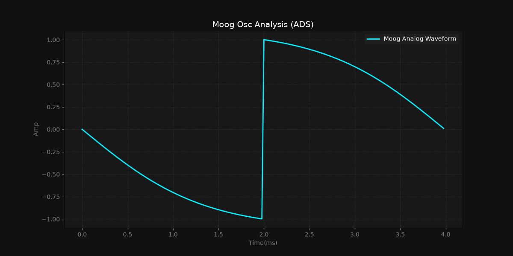

# MoogDrift-Visualizer

A Python-based Digital Signal Processing (DSP) prototype that simulates the analog drift and instability of a classic **Moog transistor ladder oscillator**. 

This project demonstrates clean architecture by separating the DSP mathematics (engine), project environment states (configuration), and the UI/visualization layers.

## Features
- **Analog Drift Simulation**: Implements frequency and phase instability based on simulated room temperature and hardware warm-up time.
- **Power Grid Jitter**: Optional emulated power supply noise using vectorized numpy random distributions.
- **Moog Saturation**: Uses hyperbolic tangent (`np.tanh`) distortion to emulate the warm, rounded edges of hardware transistor clipping.
- **Modular Design**: Completely decoupled configuration (`config.py`), DSP core (`moog_oscillator.py`), and visualization (`plotter.py`).

## Waveform Analysis

Here is the perfect single-cycle waveform generated by the core engine (with disabled environmental noises for a clean reference):



## Architecture & Code Structure
- `./include/config.py` — Centralized global dictionary managing synthesis parameters and environmental factors.
- `./include/moog_oscillator.py` — Core mathematical functions generating the cyclic sawtooth and applying analog saturation.
- `./include/plotter.py` — High-fidelity dark-themed oscilloscope visualization built on top of Matplotlib.

## Quick Start

1. Clone the repository and activate your virtual environment.
2. Install dependencies from the requirements file:
```bash 
pip install -r requirements.txt  
```
3. Run the visualizer:
```bash 
python ./include/plotter.py 
```
